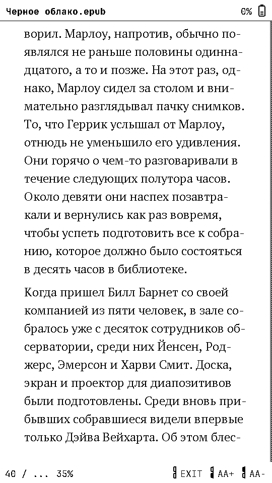

# E-Reader for M5PaperDIY

A paginated e-ink ebook reader for the M5Stack M5PaperDIY (K159 / K159-B).

- **Hardware:** M5PaperDIY, ESP32-S3, 540 × 960 parallel e-ink panel with 16 grayscale levels, PSRAM, microSD, buttons A/B.
- **Firmware:** ESP-IDF 5.5.1.
- **Formats:** TXT, Markdown, FB2, EPUB, PDF (text layer only).
- **License:** MIT.

## Screenshots

| File manager | Reading |
|:---:|:---:|
|  |  |
| Folders first, format and size metadata, and the bold selected row with its filled icon and cursor. | Paginated text with hyphenation, page/percentage footer and button hints. |

## Features

### Reader

- **Page-based layout** for every supported format. There is no scrolling: each page is laid out for the 540 × 960 screen.
- **Hyphenation** for Cyrillic words using Russian school rules, plus soft hyphens (U+00AD) already present in the book. Headings, lists and code are not hyphenated.
- **Widow and orphan control:** a paragraph is not left with one lonely line at the bottom or top of a page.
- **Three text sizes.** Book text uses PT Serif; all interface text uses JetBrains Mono.
- **Loading screen:** files above 300 KB show three discrete steps (read, parse, layout) with a progress bar; smaller books open immediately.
- **Images** in EPUB and FB2 are skipped in v1. EPUB and Markdown emit a short text placeholder.

### Navigation

- **Per-book progress:** paragraph position, character offset, page number, layout signature and file size are stored for each book. Every page turn writes the position immediately.
- **Page numbers and percentage** in the footer, plus a thin reading-progress bar. EPUB and PDF count the total in the background when memory allows; TXT, Markdown and FB2 show `N / ...` because a second full copy of the document would not fit in RAM.
- **Auto-resume:** if the device is switched off while a book is open, the next boot reopens that book at the saved position.
- **Footnote/reference mode** for FB2 books (see below).
- **Last book preselected** in the file manager after leaving the reader.

### File manager

- Folder navigation with `[..]`, directories sorted before files, and only supported extensions listed.
- Icons for folders, books and locked files; the selected row is bold, uses the filled icon and gets a cursor arrow.
- Full-height list, a 4 px scrollbar, format and size metadata.
- Files above the open limit are greyed out with a lock icon and `( ! )` before the size.

### E-ink behaviour

- **Regional updates:** the UI marks only the rectangles that changed; overlapping and adjacent rectangles are merged before they reach the panel.
- **Fast page turns:** pages use DU (`epd_fast`, roughly 330–400 ms). Every fourth page frame is forced to GC16 (about 1.3 s) to remove ghosting; `rdr clean` forces one on demand.
- **Mixed modes:** partial status-bar updates use GC16, message and repair dialogs use a full GC16 frame, and ordinary content changes use DU.
- **Safety valve:** if dirty regions cover more than 68% of the screen or 20 partial updates accumulate, the driver performs a full refresh.
- **Crisp text:** glyph masks contain only 0 and 255, so DU pages do not show half-covered pixels.

### Maintenance

- **On-device repair:** if a TXT, Markdown or FB2 file fails to parse, the reader re-encodes it as UTF-8, sanitises it and offers the result. **A** replaces the original (kept as `broken-<name>`); **B** keeps both files (`fixed-<name>`). `rdr heal <path>` runs the same repair manually.
- **Battery gauge:** percentage and level icon in the header, refreshed every 60 seconds. When the gauge is not readable, the value is shown as `--`.
- **Debug console:** `rdr ...` commands over USB-Serial-JTAG, with a Python client in `tools/devtool.py`.

## Requirements

| Item | Requirement |
|---|---|
| Board | M5PaperDIY (K159 / K159-B): ESP32-S3, 540 × 960 16-level e-ink, PSRAM, microSD, buttons A/B |
| SDK | ESP-IDF 5.5.1 with the ESP32-S3 toolchain |
| Host tools | Python 3; Pillow for the generators and `devtool.py` screenshots (freetype-py for hinted atlases); pyserial for `tools/devtool.py` |
| Card | microSD formatted as FAT32 |
| Cable | USB data cable for flashing and the serial console |

## Build and flash

Run these commands from the repository root. The board support code is the `vendor/M5PaperDIY-UserDemo` checkout; its pinned components are downloaded by `fetch_repos.py`.

```powershell
# once: initialize the vendored SDK and its pinned components
git submodule update --init --recursive
python vendor\M5PaperDIY-UserDemo\fetch_repos.py

# activate ESP-IDF 5.5.1 in the current PowerShell session
. .\tools\idf_env.ps1 -Version 5.5.1

# build and flash (COM5 -> your port)
cd firmware
idf.py build
idf.py -p COM5 flash
```

`tools/build.ps1` wraps the same steps: `.\tools\build.ps1 -Flash -Port COM5` (add `-Monitor` to open the serial monitor). `tools/idf_env.ps1` expects ESP-IDF at `C:\esp\5.5.1\esp-idf` and the tools under `C:\Espressif\tools`; adjust the script or export your own IDF environment if your installation is elsewhere.

## First run

1. Format a microSD card as FAT32 and copy books to the root or any folder.
2. Insert the card and power on. The file manager opens at the root, or at the last used folder.
3. Select a book and press **A+B** to open it.
4. Progress and settings are stored in `/sdcard/.reader/progress.json`. The `.reader` folder is created on first use; the JSON is written through a temporary file and renamed into place.

Supported files:

| Extension | What the reader does |
|---|---|
| `.txt` | Plain text. Detects UTF-8 and UTF-16LE/BE from BOMs, CP1251 from an XML declaration, then validates UTF-8 and falls back to CP1251. |
| `.md`, `.markdown` | Headings, bold and italic, lists, block quotes, inline and fenced code, horizontal rules and tables. |
| `.fb2` | XML FB2: sections, headings, emphasis/strong, footnote bodies and links. |
| `.epub` | ZIP + OPF + XHTML, chapters in spine order. Images are skipped with a text placeholder. |
| `.pdf` | Text layer only: FlateDecode, ToUnicode, xref tables and object streams; the text is reflowed for the screen. Scans are rejected. |

Progress is keyed by the book path. The entry also remembers the file size; if the file on the card changes, the old position is ignored and reading starts from the beginning. The same JSON holds the font size, the last opened file and the `reading` flag used for auto-resume.

## Controls

| Gesture | File manager | Reader |
|---|---|---|
| **A** | Cursor up | Previous page |
| **B** | Cursor down | Next page |
| **Hold A** or **hold B** | Auto-repeat cursor movement after 500 ms | Auto-repeat page turning after 500 ms |
| **A+B**, short (under 500 ms) | Enter folder, open book, or go to `[..]` | Exit to file manager (position saved) |
| **A+B**, long (800 ms or more) | Open the selected book from page 1 (drops its saved position) | Enter reference/footnote mode |
| **Hold B + tap A** | Jump to the first entry | Larger font (in reference mode: scroll note up) |
| **Hold A + tap B** | Page down, or the last entry if the page is short | Smaller font (in reference mode: scroll note down) |
| **Power key** | Single press power-cycles the board; double press powers off (handled by the PMIC, not the firmware) | Same |

While a message is shown, **A+B** dismisses it. In the repair confirmation, **A** replaces the original and **B** keeps both files.

## Reference and footnote mode

Hold **A+B** in the reader to enter reference mode for books with footnotes (currently FB2 with a `<body name="notes">` section).

- **A / B** move focus between references on the page. At a page edge the reader turns the page and focuses the first or last reference there. If the current page has none, it scans up to 25 pages forward and then backward.
- The focused reference gets the same cursor marker as the file manager.
- A note panel opens at the bottom with the printed label (for example `[1]`), the note heading when present, the note body (24 px serif), an `n/m` counter and a scrollbar for long notes.
- **Hold B + tap A** scrolls the note up; **hold A + tap B** scrolls it down. The font-size gestures are repurposed in this mode.
- **A+B (short)** leaves the mode. The page may shift up while browsing so the focused reference is not hidden behind the panel; this shift is visual only and the saved reading position does not change.
- A broken reference shows `Footnote text not found.`

## Host tests

The parser and layout tests build with a host g++ and do not need ESP-IDF. On Windows:

```powershell
.\tests\run_tests.ps1
```

Run one target:

```powershell
.\tests\run_tests.ps1 -Filter test_epub
```

The runner uses MinGW-w64 g++; the `$gxx` path at the top of `tests/run_tests.ps1` is machine-specific, so change it if your toolchain lives elsewhere. Targets are `test_txt`, `test_md`, `test_fb2`, `test_epub`, `test_pdf`, `test_links` and `test_layout`. They cover encoding detection and TXT paragraphs/seek, Markdown, FB2 and footnote links, EPUB (with the ZIP archive built in the test), PDF text/ToUnicode/xref, and layout with hyphenation.

## Tools

| Tool | Purpose |
|---|---|
| `tools/fonts/gen_fonts.py` | Regenerates the PT Serif and JetBrains Mono bitmap atlases in `firmware/main/text/atlas/`. |
| `tools/icons/import_icons.py` | Packs the PNG icon set in `icons/` into the 1-bit C++ icon atlas. |
| `tools/devtool.py` | USB serial client: screenshots, upload/download, key injection, `dump` and `bench`. |
| `tools/make_demo.py` | Generates the sample books in `demo/` (TXT, CP1251 TXT, Markdown, FB2, EPUB and PDF). |

## Project layout

```text
ereader/
  firmware/   ESP-IDF application: main/, generated font atlases, partition table
  vendor/     M5PaperDIY-UserDemo SDK checkout (M5GFX, M5Unified, LGFX_Fonts, mooncake)
  tools/      font/icon generators, serial devtool, demo generator, build scripts
  tests/      host C++ tests and run_tests.ps1
  demo/       generated sample books
  docs/       architecture, decisions, screenshots
  icons/      source PNG icons
```

## Debug console

The firmware runs a command console on USB-Serial-JTAG. Every command starts with `rdr `. `tools/devtool.py` is a convenient client.

| Command | Action |
|---|---|
| `ping` | Check the console; replies with `rdr pong`. |
| `dump` | Print the text currently drawn on screen (reader page or file list). |
| `shot [x y w h]` | Capture the panel, optionally a rectangle; `devtool.py` saves it as PNG. |
| `key A/B/AB/ABL/UP/DN` | Inject a button gesture. |
| `open <path>`, `openidx <n>` | Open a file by path or by current list index. |
| `put <path> <base64>` | Upload a file to the SD card. |
| `get <path>`, `getb64 <path>` | Download a file raw or base64-encoded. |
| `ls <dir>`, `rm <path>` | List a directory or delete a file. |
| `heal <path>` | Repair a broken TXT, Markdown or FB2 file. |
| `reset` | Forget the saved progress and return to the file manager root. |
| `clean` | Force a full GC16 repaint to clear ghosting. |
| `stats` | Print refresh counters, the last region and its duration. |
| `bat`, `pek` | Print battery millivolts/percentage, or PMIC key state. |
| `limit <bytes>` | Override the open-size limit for testing. |
| `bench` | Measure panel refresh times for several modes and areas. |
| `reboot` | Restart the board. |

## Known limitations

- **Page numbers are layout-dependent.** A saved page is restored only when the font size and margins match; after a font change the reader re-walks the book to find the page. TXT, Markdown and FB2 do not compute a total page count (the footer shows `N / ...`); EPUB and PDF count it in the background when memory allows.
- **PDF without a text layer is rejected.** Scanned, image-only PDFs show `PDF has no text layer (scans are not supported)`; there is no OCR or raster rendering.
- **Size limits are enforced before opening.** The file manager greys out files above the open limit (8 MiB for text formats and EPUB, 12 MiB for PDF); parsers may apply lower internal caps, so oversized books are refused rather than truncated.
- **The power key belongs to the PMIC.** A single press power-cycles the board and a double press switches it off; the firmware cannot use it for navigation. Progress is saved on every page turn, so a restart reopens at the same place.
- **v1 scope:** the firmware does not use Wi-Fi and has no OCR, DRM, text search or bookmarks.

## License

MIT. See [LICENSE](LICENSE).

Bundled third-party code and fonts keep their own licenses: M5GFX, M5Unified and LGFX_Fonts in `vendor/`, PT Serif (ParaType Free Font License) and JetBrains Mono (SIL OFL 1.1). Font details are in [tools/fonts/README.md](tools/fonts/README.md).

Architecture and design notes: [docs/architecture.md](docs/architecture.md) and [docs/decisions.md](docs/decisions.md).
